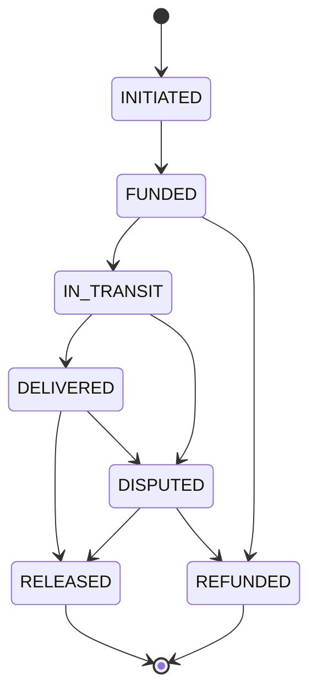

# P2P Escrow Engine (South Africa)

Neutral third-party escrow for South African online marketplaces, social commerce and freelance work.
Buyer funds are held against a gateway settlement, released to a FICA-verified seller only after
delivery is confirmed, and every state change is written to an append-only audit trail.

> **Status: v1.0.0 source release — not cleared for production traffic.**
> The escrow lifecycle, webhook idempotency and signature verification are implemented and tested.
> Payouts, KYC upload and the dispute console are **not** in this repository yet (see
> [Known gaps](#known-gaps)). Read [docs/04-bug-reports.md](docs/04-bug-reports.md) before deploying.

---

## What is implemented

| Area | Component | State |
| --- | --- | --- |
| Escrow lifecycle rules | `src/services/EscrowStateMachine.ts` | Implemented, unit tested |
| PayFast ITN signature verification | `src/services/PayFastSignature.ts` | Implemented, unit tested |
| Gateway notification policy (status + amount reconciliation) | `src/services/GatewayEventPolicy.ts` | Implemented, unit tested |
| Webhook ingestion with idempotency + row locking | `src/controllers/WebhookController.ts` | Implemented, integration tests pending a live DB |
| HTTP surface | `src/app.ts` | Implemented |
| PostgreSQL schema + append-only audit trigger | `src/db/schema.sql` | Implemented, migration not yet run in CI |
| Seller payout, KYC upload, dispute console | — | Not implemented |

## Lifecycle



Transitions are validated in code and the persisted update is guarded with
`WHERE status = <state read under row lock>`, so a concurrent writer cannot double-apply a movement.

## Webhook flow

```
POST /webhooks/payfast
  │
  ├─ 1. Raw body parsed in field order  → signature verified (MD5, constant-time compare)
  │      no passphrase configured → 503 (fail closed)
  │      bad signature            → 401
  │
  ├─ 2. Redis SET webhook:processed:<gateway_reference> NX EX 86400   (atomic claim)
  │      claim lost (retry/duplicate) → 200 OK, no reprocessing
  │
  ├─ 3. DB transaction
  │      SELECT … FOR UPDATE
  │      decision = COMPLETE && settled_amount == escrow_amount ? FUND : ignore | reject
  │      UPDATE transactions WHERE status = <locked status>
  │      INSERT audit_logs (FUNDS_CLEARED, from_status, to_status)
  │
  └─ 4. Claim marked 'processed' · on any failure the claim is released so the retry works
```

## Getting started

```bash
npm install
cp .env.example .env      # set DATABASE_URL, REDIS_URL, PAYFAST_PASSPHRASE
npm run migrate           # applies src/db/schema.sql
npm run build
npm test                  # 22 unit tests
npm start                 # http://localhost:3000/health
```

Requirements: Node.js 20+, PostgreSQL 14+, Redis 6+.

### Environment

| Variable | Required | Purpose |
| --- | --- | --- |
| `DATABASE_URL` | yes | Postgres connection string for the escrow ledger |
| `REDIS_URL` | yes | Idempotency gate (defaults to `redis://localhost:6379`) |
| `PAYFAST_PASSPHRASE` | yes | Signature salt; unset means all callbacks are refused |
| `PORT` | no | Defaults to `3000` |
| `NODE_ENV` | no | Defaults to `development` |

Never commit `.env`. Secrets belong in the deployment platform's secret store.

## Endpoints

| Method | Path | Behaviour |
| --- | --- | --- |
| `GET` | `/health` | Liveness probe, returns version |
| `POST` | `/webhooks/payfast` | Gateway notification, `application/x-www-form-urlencoded` |

Response codes: `200` accepted/duplicate, `400` malformed, `401` bad signature,
`422` signed but unreconcilable (amount mismatch), `500` transient failure (retry expected),
`503` signature verification unavailable.

## Design decisions worth knowing

- **Money is integer cents.** No floating point arithmetic in the money path.
- **Amount reconciliation is mandatory.** A `COMPLETE` notification only funds the escrow when the
  settled amount equals the escrow amount; under- and over-payments are rejected, not partly applied.
- **Idempotency is claimed before work, released on failure.** Claiming after the commit would leave a
  crash window that permits double-processing.
- **Logging is PII-shy.** Only identifiers and error messages are logged, never raw payloads.
- **The audit log is append-only in the database**, enforced by trigger, not by application discipline.

## Known gaps

1. No seller payout service — `RELEASED` is a state, not a disbursement.
2. No KYC/FICA upload pipeline; `docs/01-srs.md` §3 is unimplemented.
3. No POPIA encryption-at-rest in this codebase. Encryption of ID numbers and bank details is expected
   from the managed Postgres offering, and column-level encryption is not wired up.
4. No dispute console or evidence storage.
5. No `CANCELLED`/`EXPIRED` state: abandoned `INITIATED` escrows currently sit forever.
6. Integration tests need live Postgres and Redis; only pure units are covered here.
7. The signature vector in `tests/PayFastSignature.test.ts` is a regression guard, not a proof of
   interoperability — validate against the PayFast sandbox before go-live.

## Documentation

| Document | Contents |
| --- | --- |
| [docs/01-srs.md](docs/01-srs.md) | Requirements specification and decision log |
| [docs/02-design-notes.md](docs/02-design-notes.md) | Retrospective design of what was built |
| [docs/03-test-plan.md](docs/03-test-plan.md) | Test strategy, cases and coverage gaps |
| [docs/04-bug-reports.md](docs/04-bug-reports.md) | Defects found in the reviewed source, with fixes |
| [docs/05-release-notes-1.0.0.md](docs/05-release-notes-1.0.0.md) | Release scope and corrections |
| [docs/06-maintenance-runbook.md](docs/06-maintenance-runbook.md) | Monitoring, backup and incident procedures |

## Licence

Proprietary. All rights reserved.
