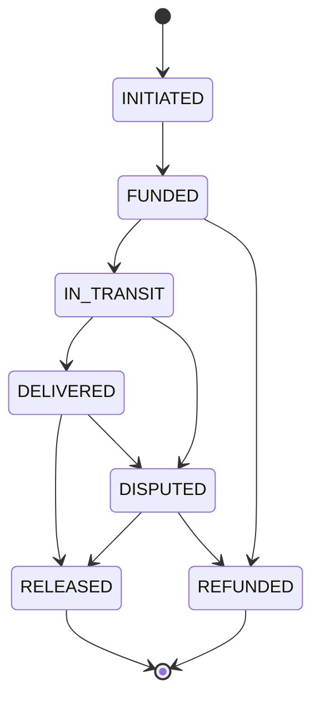

# P2P Escrow Engine (South Africa)

A neutral third-party escrow engine for South African marketplaces, social commerce and freelance
work. Buyer funds are held against a gateway settlement, released only after delivery is confirmed,
and every state change is written to an append-only audit trail.

**Live simulator:** https://sklevel8-p2p-escrow.netlify.app
**Stack:** TypeScript · Express · PostgreSQL · Redis · PayFast ITN

> **Status: v1.0.0 source release — not cleared for production traffic.** The escrow lifecycle,
> webhook idempotency and signature verification are implemented and unit-tested. Payouts, KYC
> upload and the dispute console are not in this repository yet. See
> [Known gaps](#known-gaps) before deploying.

---

## Why this exists

Peer-to-peer selling in South Africa runs on trust that the participants do not have. A buyer will
not send R1 500 to a stranger on Facebook Marketplace, and a seller will not ship a phone to someone
who says they paid. Escrow resolves that standoff — but only if the money movement is genuinely
safe, and "genuinely safe" is a much narrower set of requirements than most integrations achieve:

- **A payment callback must never be applied twice.** Gateways retry. Networks duplicate. A bug here
  pays a seller twice, and the money is gone.
- **A callback must never fund the wrong amount.** A R1 payment and a R1 500 escrow are the same
  event type. Amount reconciliation has to be exact, in integer cents.
- **A signature check must fail closed.** If the passphrase is missing, the correct behaviour is to
  refuse traffic, not to skip verification.
- **State must not be skippable.** `INITIATED → DELIVERED` without funds is a fraud path, so the
  legal transitions are a table in code, not an `if` scattered through controllers.
- **The audit trail must be append-only in the database**, not by convention in the application.

This repository is the engine that answers those five requirements, with the gaps documented rather
than glossed over.

## How it works

### Lifecycle



Transitions are validated in `EscrowStateMachine`, and the persisted update is guarded with
`WHERE status = <the status read under a row lock>`. A concurrent writer cannot double-apply a
movement even if two requests interleave.

### Webhook flow

```
POST /webhooks/payfast
  │
  ├─ 1. Raw body parsed in field order → signature verified (MD5, constant-time compare)
  │      no passphrase configured → 503 (fail closed)
  │      bad signature           → 401
  │
  ├─ 2. Redis SET webhook:processed:<reference> NX EX 86400   (atomic claim)
  │      claim lost (retry/duplicate) → 200 OK, no reprocessing
  │
  ├─ 3. DB transaction
  │      SELECT … FOR UPDATE
  │      decision = COMPLETE && settled_amount == escrow_amount ? FUND : ignore | reject
  │      UPDATE transactions WHERE status = <locked status>
  │      INSERT audit_logs (FUNDS_CLEARED, from_status, to_status)
  │
  └─ 4. Claim marked processed → on any failure the claim is released so the retry works
```

The ordering is deliberate. The idempotency claim is taken **before** the work, because claiming
after the commit leaves a crash window that permits double-processing. And the claim is released on
failure, because a claim that survives a failed transaction would permanently drop a legitimate
retry.

### Endpoints

| Method | Path | Behaviour |
| --- | --- | --- |
| `GET` | `/health` | Liveness, returns version |
| `POST` | `/webhooks/payfast` | Gateway notification (`application/x-www-form-urlencoded`) |

Response codes: `200` accepted/duplicate · `400` malformed · `401` bad signature · `422` signed but
unreconcilable (amount mismatch) · `500` transient failure (retry expected) · `503` verification
unavailable.

## Design decisions worth knowing

- **Money is integer cents.** No floating-point arithmetic anywhere in the money path.
- **Amount reconciliation is mandatory.** A `COMPLETE` notification funds the escrow only when the
  settled amount equals the escrow amount. Under- and over-payments are rejected, never partly
  applied.
- **Idempotency is claimed before work and released on failure.**
- **Logging is PII-shy.** Identifiers and error messages only; raw payloads are never logged.
- **The audit log is append-only in the database**, enforced by trigger.

## Run it locally

Requirements: Node.js 20+, PostgreSQL 14+, Redis 6+.

```bash
npm install
cp .env.example .env     # DATABASE_URL, REDIS_URL, PAYFAST_PASSPHRASE
npm run migrate
npm run build
npm test                 # 22 unit tests
npm start                # http://localhost:3000/health
```

| Variable | Required | Purpose |
| --- | --- | --- |
| `DATABASE_URL` | yes | Postgres ledger |
| `REDIS_URL` | yes | Idempotency gate (default `redis://localhost:6379`) |
| `PAYFAST_PASSPHRASE` | yes | Signature salt; unset means all callbacks are refused |
| `PORT` | no | Default `3000` |
| `NODE_ENV` | no | Default `development` |

Never commit `.env`.

## The deployed simulator

Netlify publishes `web/` — an interactive model of the same state machine. You can drive a sample
escrow through its legal transitions, attempt an illegal one to see it rejected, and watch the audit
trail and gateway decision logic respond. It is a teaching aid for the engine, not a substitute for
it: there is no database and no gateway behind it.

## Project layout

```
src/services/EscrowStateMachine.ts    transition table and guards
src/services/PayFastSignature.ts      MD5 signature verification
src/services/GatewayEventPolicy.ts    status + amount reconciliation
src/controllers/WebhookController.ts  ingest, idempotency, row locking
src/db/schema.sql                     schema plus append-only audit trigger
src/app.ts                            HTTP surface
tests/                                22 unit tests
docs/                                 SRS, design notes, test plan, bug reports, runbook
web/                                  deployed state-machine simulator
```

## Known gaps

1. No seller payout service — `RELEASED` is a state, not a disbursement.
2. No KYC/FICA upload pipeline.
3. No POPIA encryption-at-rest wired up in this codebase (column-level encryption is not
   implemented; it is assumed to come from the managed Postgres offering).
4. No dispute console or evidence storage.
5. No `CANCELLED`/`EXPIRED` state, so abandoned `INITIATED` escrows sit forever.
6. Integration tests need live Postgres and Redis; only pure units are covered here.
7. The signature vector in `tests/PayFastSignature.test.ts` is a regression guard, not proof of
   interoperability — validate against the PayFast sandbox before go-live.

These are listed because an escrow engine is a poor place for optimism.

## Documentation

| Document | Contents |
| --- | --- |
| `docs/01-srs.md` | Requirements specification and decision log |
| `docs/02-design-notes.md` | Retrospective design of what was built |
| `docs/03-test-plan.md` | Test strategy, cases and coverage gaps |
| `docs/04-bug-reports.md` | Defects found in reviewed source, with fixes |
| `docs/05-release-notes-1.0.0.md` | Release scope and corrections |
| `docs/06-maintenance-runbook.md` | Monitoring, backup, incident procedures |

## Licence

Proprietary. All rights reserved.
